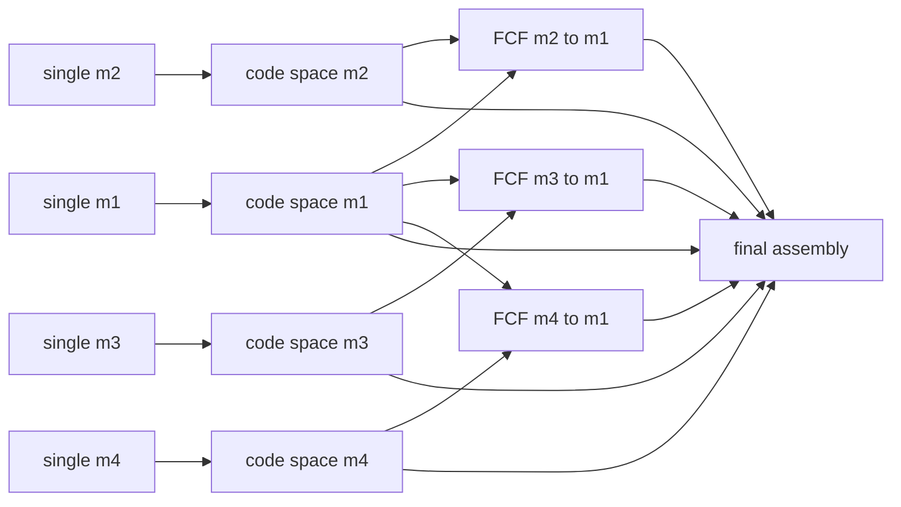

# CodeAlign 对 DOMA 双数据集的本地代码适配

本次基线为 `75d5ecd359d36a64a3af3d64c4fe32e72ed344bc`。交付了可审查的独立训练链、数据接口、阶段权重校验、完整续训、联合推理和 AP 导出代码。本地没有真实数据和 CUDA/spconv，不能将这些结果描述成训练通过或双数据集 AP 已完成。

**协议证据分级**：OPV2V 来自 DOMA 已保存的正式运行配置快照；V2XSet 来自用户指定的本地 V2 参考 YAML。服务器路径仅知 `/home/fkk/my_data/disk2/code/DOMA`，没有取得 V2XSet 最终实际运行配置、CLI 和锁文件。两套 `protocol_lock.yaml` 均明确将最终运行参数确认标记为 `SERVER_VALIDATION_REQUIRED`，当前值是有来源的候选值，不能当作已确认的服务器最终协议。代码适配可继续，正式对比前需用真实记录核验并同步修改锁文件与 final YAML。

## 1. 方法边界和原生实现审查

依据 [CodeAlign 论文](https://arxiv.org/html/2603.00609v1)、本地 README，以及三个 `heter_codebook_shared_head*.py`、`c2c_module.py`、编码器、trainer、dataset、postprocessor 和 evaluator 的实际代码。

原生实现的链条是：独立感知模型预训练 → 固定感知网络的 Codebook/Aligner 训练 → 只训练 FCF Translator → 接收端 Codebook 解码、PyramidFusion 和检测头。模态隔离要求不同源模态不共享训练场景；跨模态 FCF 只使用源模态自己的观测与检测标签。

新增 `codealign_doma_protocol` 是这些**原生 CodeAlign 组件的隔离组装入口**，没有调用 DOMA 模型、对象几何残差、共识细化或权重。重用的是 CodeAlign 自己原本就使用的 `UMGMQuantizer`、`AlignNet(resnet3x3)`、`Translator(convnext)`、`PyramidFusion`、`DownsampleConv` 和原生 `PointPillarPyramidLoss`。官方三个模型及其 YAML、损失、FCF 和 Codebook 源码保持原样。

原生模型直接在构造器中使用 `cuda:{rank}` / `.to(rank)`、跨阶段绝对路径与部分加载；这不适合作为本次严格依赖入口。新增组装器先构建模块，再由阶段状态工具按模块所有者严格装载，避免修改其算法内部。唯一新增的特征处理是同一 0.8 m 栅格上的中心裁剪/补零；没有学习式额外网络，也没有把不同物理范围拉伸成相同尺寸。

原生 shared-head 前向只输出融合检测头，没有单体检测预测；本协议显式 `supervise_single: false`，避免 trainer 额外调用不存在的单体输出。保留原生融合检测、方向、深度（有标签时）和 pyramid occupancy 损失。四组都是 singleton code space，不使用组内跨模态相似度项；原生 Codebook 重建误差保留在输出中，按原生 singleton YAML 不额外给它添加损失权重。FCF 训练使用原生 hard Gumbel 和冻结目标解码器，验证/推理使用 translator argmax 分支。原生 ego Quantizer 的采样实现保留，随机状态受 seed 控制；不承诺 CUDA 位级确定性。

## 2. 数据、来源和模态映射

| 统一 ID | CodeAlign 原生对应 | OPV2V 输入 | V2XSet 输入 | 编码器 |
|---|---|---|---|---|
| m1 | 原生 m1 | 原始 PCD；64 线身份需数据记录支持 | 原始 PCD；不声明线数 | PointPillar |
| m2 | 原生 m7 | RGB + depth extension | RGB，无深度监督 | LSS + EfficientNet-B0 |
| m3 | 原生 m2 的 SECOND，另配 OPV2V 32 线读取 | `OPV2V_Hetero/.../*_32.pcd` | **原始 `.pcd` + SECOND** | SECOND |
| m4 | 原生 m6 | RGB + depth extension | RGB，无深度监督 | LSS + Resnet101 |

这不是将原生 m1–m4 的名称直接复用。新 YAML 直接写入统一物理含义，训练 assignment 的槽位映射到单一源模态，最终 assignment 使用恒等映射。V2XSet 不设置 `lidar_channels_dict` 的条目，也不会生成 `_32.pcd` / `_16.pcd` 路径；该设计已由用户在 2026-10-27 明确确认，**不是阻塞项**。

`CamEncode` 和 `CamEncode_Resnet101` 与 DOMA 对应类 AST 完全一致。需要如实说明：现有 LSS 的 Resnet101 实现只保留 trunk 的 conv1/layer1/layer2，layer3 为 Identity；保持了 DOMA 和 CodeAlign 的同一真实实现，不能声称运行完整的 ResNet101 分类干路。

| 模态 | 核心接口 | 本地训练 BEV（H×W） | 预处理 |
|---|---|---|---|
| m1 | Pillar 64 → BEV backbone 64 | 128×256 | voxel `[0.4,0.4,4]`，32 点/voxel，32000/70000 voxels |
| m2 | LSS 128 → backbone 64 | 128×128 | 4 cameras，384×512，depth bins `[2,50,48]`，LID |
| m3 | XYZI 4 → MeanVFE → spconv → HeightCompression 128 → backbone 64 | 120×240 | voxel `[0.1,0.1,0.1]`，5 点/voxel，32000/70000 voxels |
| m4 | LSS 128 → backbone 64 | 128×128 | 4 cameras，336×448，depth bins `[2,50,48]`，LID |

各 encoder/backbone、camera augmentation、grid、depth 和 voxel 设置逐项复制对应 DOMA 配置，由 checker 比较。m3 的输入四维点特征在本仓库通过 MeanVFE 和 `num_point_features=4` 实现，没有另一个名为 PointFeatureEncoder 的阶段。新增 PCD 兼容读法保持 RGB-encoded intensity 的原有行为；对于只有 `x/y/z/intensity` 的合法 PCD 直接读取实际 intensity，不补假特征，也不猜测归一化。后者的实际数值尺度必须在服务器对照 DOMA 数据读取结果核验。

两个数据集独立使用 `dataset/OPV2V/{train,validate,test}` 和 `dataset/V2XSET/{train,validate,test}`。OPV2V 还需要 `dataset/OPV2V_Hetero` 中同场景/车辆/帧的 32 线点云与 depth，以及原目录或 additional 目录中的 visibility 标签。它是 **OPV2V + OPV2V-H 扩展协议**，不能仅按目录名称宣称纯 OPV2V。不得用目录重命名替代数据身份审查。

V2XSet 使用原生 `V2XSETBaseDataset`，保留无深度标签、camera range 标签构建以及缺相机场景 `2021_09_09_13_20_58` 排除。为了统一样本可用性，本协议在所有训练阶段及 CAV1–4 中一致排除该场景。实际 split/scene/frame 数量只能由真实数据扫描确定；assignment 的场景数不是样本数量。

## 3. 已提取的协议与差异

| 项目 | OPV2V 证据/配置 | V2XSet 证据/配置 | 状态 |
|---|---|---|---|
| 来源 | DOMA `V2_R2_TABLE4_EXT/history_snapshot.json` 中 Full 正式保存配置 | DOMA `v2xset/MoreModality/DOMA/V2/` | 前者是历史运行快照；后者仅本地参考 |
| train/validate/test | 三个明确独立目录 | 三个明确独立目录 | 服务器需核验软链接及实际数据身份 |
| m1 训练范围 | `[-102.4,-51.2,-3,102.4,51.2,1]` | 相同本地参考值 | 已提取，不用早期 square V2 配置替代 |
| m2/m4 训练范围 | `[-51.2,-51.2,-3,51.2,51.2,1]` | 相同本地参考值 | 保留 camera grid |
| m3 训练范围 | `[-96,-48,-3,96,48,1]` | 相同本地参考值 | OPV2V 32 线；V2XSet 原始点云 |
| 训练通信范围 | 70 m | 70 m | 来自实际 YAML |
| 最终候选评估范围 | `[-204.8,-102.4,-3,204.8,102.4,1]` | 相同入口默认值候选 | **SERVER_VALIDATION_REQUIRED**，不是已核验 CLI |
| 最终候选通信范围 | 180 m | 180 m | 来自 DOMA ordered entry，实际运行仍需确认 |
| NMS / score | 0.15 / 0.2 | 0.15 / 0.2 | 来自各 final YAML |
| GT max_num | 100（保存的 final YAML） | 150（本地 final YAML） | 保持分别提取的值；不统一猜成 150 |
| GT max_cav | 5 | 5 | 全部可用 GT，在输入 prefix 截断前构建 |
| depth | true | false | 配置与传感器数据分别处理 |

早期 DOMA V2 OPV2V YAML 是 square range；正式保存的 V2_R2 stage1 实际是 rectangular range。STAMP 的预算和旧文档不能覆盖这里的证据。历史 OPV2V infer.log 确认测试目录和四组 AP，但没有完整 CLI，故不能用它证明默认推理范围就是当时实际参数。

assignment 与当前本地 DOMA 的两套 JSON 分别相同，训练/evaluation 场景数是 OPV2V 68/16、V2XSet 58/19。raw hash 与保持插入顺序的规范 hash 均在 lock 中。V2XSet 的 `-1` 是基础设施 CAV，不可直接判为占位符；它位于车辆后，真实有效性由数据目录/相机/标定/点云审计确认。不得从这些 JSON 数量推断数据集 split 的实际帧数。

## 4. 独立配置及训练预算

配置根分别为：

- `opencood/hypes_yaml/opv2v/doma_protocol_codealign_v2/`
- `opencood/hypes_yaml/v2xset/doma_protocol_codealign_v2/`

每个根含 12 个可解析 `config.yaml`，以及 `protocol_lock.yaml` 和 `manifest.yaml`。所有命令读取 experiment root 中人工审查的实际 `config.yaml`；运行器不生成临时训练参数、不偷偷改 epoch/batch/LR，也不使用时间戳目录。

| 阶段 | 配置目录 | epoch / batch | Adam LR | 预算来源 |
|---|---|---|---|---|
| 单模态 | `single/m1` … `single/m4` | 50 / 1 | 0.002 | 官方 `codebook/pyramid.yaml` |
| 编码空间 | `code_space/m1` … `code_space/m4` | 50 / 1 | 0.002 | 官方 `codebook_pyramid_fixenc_aligner.yaml` |
| FCF | `fcf/m2_to_m1` … `fcf/m4_to_m1` | 30 / 1 | 0.001 | 官方 `codebook_pyramid_c2c.yaml` |

Codebook 用 64 channels、单 segment、16 entries、单 quantization level；与原生 16-code setting 一致。不同原生模板还出现 64-entry 配置，不能混载。scheduler、eval/save frequency 都在 YAML，不在 shell/runner 中写死。预算是 CodeAlign 原生方法预算，**没有宣称与 DOMA 的训练计算量相等**。

所有训练阶段使用相同规则：按训练 assignment 中场景插入位置 mod 4 分成 m1–m4 的互斥源场景。每个源的三个阶段只见这个源的场景；同帧内所有协作者均是该源模态。验证使用 validate split 上相同 shard 规则，test split 从不用于优化/选权重。全量数据扫描还检查三 split 的场景与软链接不重叠。分片会减少每个单模态可用训练场景，是保留 CodeAlign 隔离设定的明确代价；不能把这一点隐藏成“所有方法训练数据完全相同”。

## 5. 训练依赖与权重



| 阶段 | 更新 | 冻结/来源 |
|---|---|---|
| single/mi | 源 encoder、BEV backbone、fusion/shrink/heads | 无 Codebook/Aligner/Translator |
| code_space/mi | mi Aligner + mi Codebook | 严格加载 single/mi 的 encoder/backbone/fusion/heads，并冻结参数及 BN |
| fcf/mi_to_m1 | mi Translator | encoder/backbone/aligner 来自 code_space/mi；m1 Codebook/fusion/shrink/heads 来自 code_space/m1；全部冻结 |
| final_infer | 全部 eval | 每个 mi 的 encoder/backbone/aligner/codebook 来自 C_i；三 translator 来自 T_i；后端来自 C1 |

固定 ego=m1，所以最小完整转换图只有 m2→m1、m3→m1、m4→m1；无需训练 m1→相机、相机互转等 12 个有向排列。FCF 的监督来自源数据经**冻结的目标 Codebook 解码器与检测后端**产生的检测误差，梯度仍通过冻结解码器传回 Translator。最终 m1 自身经过自己的 Codebook；其余协作者走 dense→16-code→m1 feature 路径。源 Codebook 的权重仍装配并审计，dense-to-code 推理中无需再次量化源特征。

四个 single 分支可以独立并行，各 C_i 只等 S_i；T_i 等 C_i 和 C1，之后三个 T_i 可以并行。两张 GPU 可各跑一个独立阶段，每个进程只见一张卡。例如 GPU0 跑 m1、GPU1 跑 m2；各自完成后继续对应 code_space；之后按依赖安排 m3/m4/FCF。不要让两个进程写同一个阶段目录。

本运行器明确支持 **每阶段单 GPU**，检测 `WORLD_SIZE>1` 即拒绝；没有宣称 DDP 已支持或 sampler 已验证。多 GPU 的 sampler 行为通过拒绝未支持的分布式调用明确处理。物理卡由 `CUDA_VISIBLE_DEVICES` 选择，内部使用逻辑 `cuda:0`。

不直接复用 DOMA 特有权重。当前没有一份已经核验、可直接当本协议 single 完成结果的外部 checkpoint，默认全部 single 重训。m2 仅按原生 EfficientNet-B0 ImageNet 初始化（需缓存），不是已完成的 CodeAlign 训练阶段；m4 原生 Resnet101 trunk 是 `pretrained=False`。

## 6. Checkpoint 与复现

原生 `load_saved_model()` 会优先选择 bestval 并以 `strict=False` 装载；原 trainer 只存模型，没有完整 optimizer/scheduler/RNG。这些入口没有被改写，本协议使用独立严格路径。

- `best.pth`：该阶段最小验证损失，供子阶段/最终装配选择；只保留一个确定名字，不靠 glob 排序猜测。
- `latest.pth`：每个完成 epoch 的模型、optimizer、scheduler、Python/NumPy/PyTorch CPU/CUDA RNG、train/val generator、best 记录、config/lock/code/parent hash、样本集合 hash。**续训只从 latest 读**。
- `epoch_NNNN.pth`：YAML save_freq 指定的快照；不删除既有快照。
- `complete.json`：训练完成及 best hash，父阶段未完成不能被消费。
- `input_audit.json`：权重来源、可训练参数、样本数量、逻辑 GPU 与配置指纹。

装配逐 tensor 验证键、shape、dtype、所有者和 FCF 中冻结权重的逐值相等；缺键不回退随机初始化。父模型必须来自同一实验/数据集的已完成阶段，路径、config、code 和 lock hash 必须匹配。

仅支持完成 epoch 边界续训；中断的当前 epoch 从上个 latest 重新执行。每个 epoch 的成员排序、worker、NumPy、Python 与 torch 流由 YAML seed 和 epoch 确定；`persistent_workers: false` 是重现约束。默认 seed=303，可在正式首轮运行前同步修改 YAML 的 seed 字段。改变已开跑配置后不能继续复用 checkpoint。

每阶段有自己的 `config.yaml`、`train.log`、checkpoint 和 `tensorboard/`；最终有 `assembly.json`、`assembly.log`，及 `CAVn/inference.log`。没有公共 run_logs，也不会在训练结束自动启动测试。所有日志由 Python runner 保存；额外 shell tee 不是必须。

## 7. 推理与 AP

最终候选范围在 YAML 明确写入，避免原生 CLI 默认值悄悄覆盖。LiDAR voxelization 的范围和 postprocess/GT/anchors 同步采用 final extent；相机本地 grid 保留，做物理范围补零。FCF 训练先把源的 0.8 m BEV 放到 m1 训练 canvas，最终 canvas 为 256×512，参数 shape 无需因此变化。

每个数据集分别调用 `infer --use-cav 1/2/3/4`。DataLoader 使用相同 test split 和同一 in-order assignment，ego 不替换、不重新排序。沿用 DOMA 对**通信范围内成员**的有序 prefix：先生成所有有效 CAV 的 GT，再限制模型输入；数据本来不足 n 个 CAV 的帧仍然保留，不筛帧补齐。若范围排除了某个中间槽位，现有 DOMA 的 in-range prefix 可能不再等于 m1/m2/m3/m4 的累积前缀。新增检查会让整次推理报错，不输出 AP；不会用后续模态替代、重排或删除该帧。这种情况需在服务器对照 DOMA 运行记录统一处理。

模型只编码 `agent_modality_list` 中的成员；尾部成员不会经过融合产生贡献。未参与成员仍可贡献 GT，符合参考定义。特别保留 DOMA ordered entry 的 `visualize=True` 数据集构建：这个标志使所有成员的评估 GT 使用 LiDAR 标签分支，不能因不保存图片而改成 False。训练仍按模态选择各自标签。每次运行统计 ego Codebook 和实际 FCF 路径的调用计数；没有路径计数即拒绝输出正式结果。

AP 直接调用原生 `caluclate_tp_fp()` / `calculate_ap()`，不改数学定义；输出：

- `final_infer/CAVn/result.json`：原始双精度 AP30/AP50/AP70、样本/GT/assignment/checkpoint/lock hash 与运行参数。
- `raw_statistics.json`：每阈值的原始 TP/FP/score/GT 数量。
- `sample_ledger.json`：逐帧场景、timestamp、实际参与模态和 GT 数量。
- `ap_summary.json` / `.csv`：四组结果，CSV 保留 8 位小数。

汇总前强制比较四组的样本集合、GT 几何 hash、assignment、模型、范围和 prefix。如果不一致，拒绝汇总。结果目录按数据集和 CAV 隔离，拒绝覆盖已经完成的 AP 结果。

与 DOMA 的 15 个关键代码符号 AST 比较有 14 个完全相同。`generate_gt_bbx` 只在 CodeAlign 多矩阵分支不同；本路径 `collate_batch_test` 提供的是 4×4 identity，因此执行相同公共分支。审计记录位于 `docs/protocol_sources/code_implementation_audit.json`。

## 8. 服务器命令模板（本地没有执行）

在 Silas 的 CodeAlign checkout 内使用现有 HEAL/CodeAlign 环境。先人工核对 DOMA 实际 final YAML、CLI、GT 与数据记录，修正候选锁及 final YAML 后再准备实验目录。不要把这里的本地参考状态当作最终协议已批准。

```bash
# 必须自行填真实已存在路径；不假装已知服务器数据存放位置。
export OPV2V_DATA_ROOT=/actual/OPV2V
export OPV2V_HETERO_ROOT=/actual/OPV2V_Hetero
export V2XSET_DATA_ROOT=/actual/V2XSET
test -d "$OPV2V_DATA_ROOT/train" && test -d "$OPV2V_HETERO_ROOT/train"
test -d "$V2XSET_DATA_ROOT/train"
mkdir -p dataset
# 仅在对应目标不存在时创建；已有链接由 readlink -f 审核，绝不覆盖。
test -e dataset/OPV2V || test -L dataset/OPV2V || ln -s "$OPV2V_DATA_ROOT" dataset/OPV2V
test -e dataset/OPV2V_Hetero || test -L dataset/OPV2V_Hetero || ln -s "$OPV2V_HETERO_ROOT" dataset/OPV2V_Hetero
test -e dataset/V2XSET || test -L dataset/V2XSET || ln -s "$V2XSET_DATA_ROOT" dataset/V2XSET
readlink -f dataset/OPV2V dataset/OPV2V_Hetero dataset/V2XSET

python -B -m opencood.tools.check_codealign_doma
python -B -m pytest -q tests/test_codealign_protocol.py -p no:cacheprovider
python -B -m opencood.tools.check_codealign_doma --check-data --dataset opv2v
python -B -m opencood.tools.check_codealign_doma --check-data --dataset v2xset

export OPV2V_RUN=opencood/logs/CodeAlign_OPV2V_1GPU_SEED303
export V2XSET_RUN=opencood/logs/CodeAlign_V2XSET_1GPU_SEED303
python -B -m opencood.tools.run_codealign_doma prepare --dataset opv2v --experiment-root "$OPV2V_RUN"
python -B -m opencood.tools.run_codealign_doma prepare --dataset v2xset --experiment-root "$V2XSET_RUN"

# 只打印所有阶段命令，不启动任何进程。
bash scripts/codealign_doma_commands.sh opv2v "$OPV2V_RUN"
bash scripts/codealign_doma_commands.sh v2xset "$V2XSET_RUN"
```

逐阶段单卡执行示例。`RUN` 分别设为上述两个独立实验；两者的权重不能混用。

```bash
export RUN="$OPV2V_RUN" # V2XSet 另一次改为 "$V2XSET_RUN"
export DATASET=opv2v    # V2XSet 另一次改为 v2xset
export CUDA_VISIBLE_DEVICES=0
python -B -m opencood.tools.check_codealign_doma --cuda-smoke --dataset "$DATASET" --stage final_infer --experiment-root "$RUN"
# shape smoke 使用明确标记的随机权重，只验证接口，不是 AP/训练。
python -B -m opencood.tools.run_codealign_doma train --experiment-root "$RUN" --stage single/m1
python -B -m opencood.tools.run_codealign_doma train --experiment-root "$RUN" --stage single/m2
python -B -m opencood.tools.run_codealign_doma train --experiment-root "$RUN" --stage single/m3
python -B -m opencood.tools.run_codealign_doma train --experiment-root "$RUN" --stage single/m4
python -B -m opencood.tools.run_codealign_doma train --experiment-root "$RUN" --stage code_space/m1
python -B -m opencood.tools.run_codealign_doma train --experiment-root "$RUN" --stage code_space/m2
python -B -m opencood.tools.run_codealign_doma train --experiment-root "$RUN" --stage code_space/m3
python -B -m opencood.tools.run_codealign_doma train --experiment-root "$RUN" --stage code_space/m4
python -B -m opencood.tools.run_codealign_doma train --experiment-root "$RUN" --stage fcf/m2_to_m1
python -B -m opencood.tools.run_codealign_doma train --experiment-root "$RUN" --stage fcf/m3_to_m1
python -B -m opencood.tools.run_codealign_doma train --experiment-root "$RUN" --stage fcf/m4_to_m1
# 仅中断恢复时使用 --resume，读取该阶段 latest，而不是 best。
# python -B -m opencood.tools.run_codealign_doma train --experiment-root "$RUN" --stage fcf/m2_to_m1 --resume
python -B -m opencood.tools.run_codealign_doma assemble --experiment-root "$RUN"
python -B -m opencood.tools.run_codealign_doma infer --experiment-root "$RUN" --use-cav 1
python -B -m opencood.tools.run_codealign_doma infer --experiment-root "$RUN" --use-cav 2
python -B -m opencood.tools.run_codealign_doma infer --experiment-root "$RUN" --use-cav 3
python -B -m opencood.tools.run_codealign_doma infer --experiment-root "$RUN" --use-cav 4
python -B -m opencood.tools.run_codealign_doma summarize --experiment-root "$RUN"
```

## 9. 环境、验证边界和限制

沿用 CodeAlign/HEAL 的现成 Python/PyTorch/CUDA 环境与 requirements，不做依赖升级。新增完整状态读取兼容带/不带 `weights_only` 参数的 PyTorch。需要 spconv（v1 或兼容 v2/cumm）、torchvision、efficientnet_pytorch、timm、torch_scatter、pypcd、open3d、tensorboardX 等既有依赖。根据环境编译 torch_scatter 和 `opencood/pcdet_utils` 的 IoU/NMS CUDA 扩展；LSS 使用原生 QuickCumsum autograd，不把 CPU 检查当成 CUDA 数值对齐。EfficientNet-B0 缓存需预先准备；不声称已有检测预训练 checkpoint。

本地环境是 Python 3.12.4、torch 2.7.0+cpu；缺少 spconv、torch_scatter、timm、icecream、tensorboardX，且没有 dataset。已通过 24 阶段 YAML、协议/依赖/来源/assignment 检查、原生 Codebook CPU 前后向及 FCF 梯度测试、完整状态续训契约、Python 编译与 diff whitespace 检查。具体证据见第二份协议检查文档和 JSON。

待服务器验证：完整 DataLoader/相机和点云读入、真实训练/反向、原生算子、实际显存、完整阶段装配、四组同样本 GT 与 AP。最终大范围 SECOND + Camera/LSS + dense Codebook 可占大量显存，默认 batch=1 也不构成显存保证；先做 shape smoke 和测峰值。workers/prefetch/pin_memory 由 YAML 控制；模型结构和正式样本协议不因资源优化而改变。

不连接服务器、不启动 screen/tmux、不自动训练/推理、不 commit、不 push。本次所有源码与产物写入均位于 CodeAlign；DOMA/HEAL/STAMP 只读。
